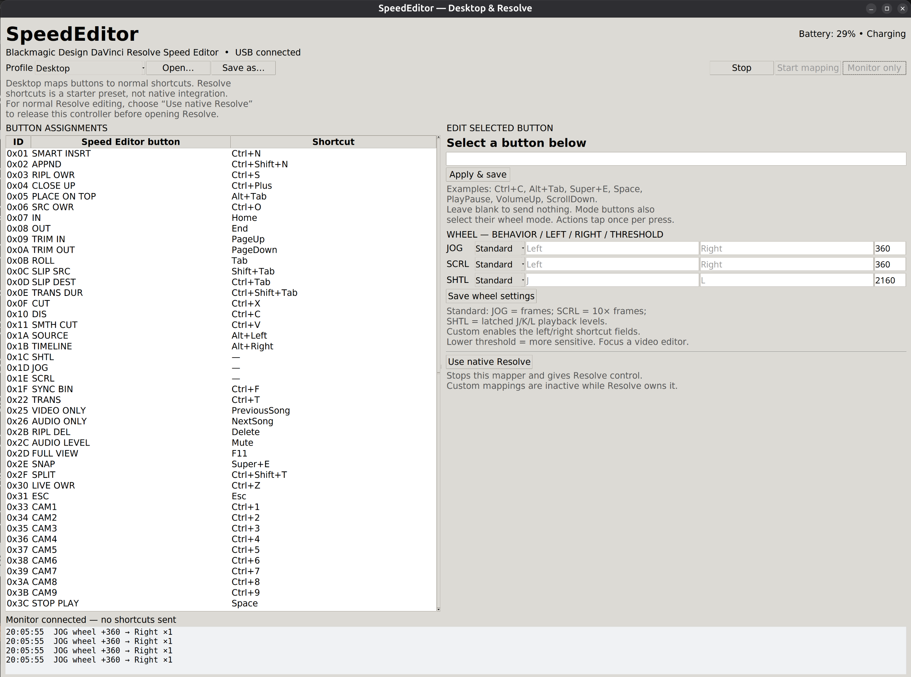

# SpeedEditor

A Linux desktop app that turns the **Blackmagic Design DaVinci Resolve Speed
Editor** into a configurable shortcut controller over USB.

Edit all 43 buttons, configure three wheel modes, and see the battery percentage
and charging status without enabling keyboard output.



*The screenshot shows the earlier shortcut-only wheel editor. Current builds
also include a Standard / Custom selector for each wheel mode.*

## Platform support

| Platform | Status |
| --- | --- |
| Linux | Implemented; tested with a USB-connected Speed Editor on a Wayland desktop |
| Windows 11 | **Not supported by the current version** |
| macOS | Not supported by the current version |
| Bluetooth | Not implemented; connect the controller by USB |

Device discovery and USB access use Linux sysfs and hidraw. Keyboard and scroll
output use Linux uinput through `evdev`. The output backend is designed for
Wayland and X11; X11 desktop shortcut delivery has not been verified. A Windows
version would need different device-access and keyboard-output backends. The
current Python app does not run on Windows as-is.

## Features

- Assign a shortcut to any of the **43 physical buttons**.
- Start with Desktop shortcuts for editing, navigation, browser tabs, and media.
- Configure independent **JOG**, **SCRL**, and **SHTL** wheel maps.
- Standard transport is the default: frame jog, faster timeline search, and
  latched forward/reverse shuttle levels. Override any mode with Custom shortcuts.
- Adjust wheel sensitivity separately for each mode.
- Open and save JSON profiles, with validation and live updates.
- Monitor button presses, wheel movement, and battery reports without sending shortcuts.
- Read the battery automatically every five seconds, including while mapping and
  monitoring are stopped. The display explicitly shows **Charging** or **Not charging**.
- Size assignment rows to the displayed font, keeping the list compact at high DPI.
- Release the controller using **Use native Resolve**.

See [KEYMAP.md](KEYMAP.md) for every hardware button ID and the starter assignments.

## Install and run

### Requirements

- Linux with Python 3.10 or newer, tkinter, and Python venv support.
- A C compiler, Python development headers, and Linux input headers to build `evdev`.
- systemd/udev and `setfacl` (usually provided by the `acl` package) for device-access setup.
- A Speed Editor connected by USB, with USB ID `1edb:da0e`.

Install the prerequisites using your Linux distribution's package manager, then:

```sh
git clone https://github.com/russellmm/SpeedEditor.git
cd SpeedEditor
./setup.sh
sudo bash ./install-device-access.sh
./run.sh doctor
./run.sh
```

Run **device-access setup once**. It grants the local user access to this specific
USB HID device and `/dev/uinput`, which allows mapped keyboard and wheel output.
It writes `/etc/udev/rules.d/70-speededitor.rules`, loads uinput, and applies access
to the connected device. It does not grant raw access to other keyboards or add
you to the input group. Reconnect the USB cable if access is not available yet.
Run the app itself as your normal user.

To undo that setup, remove `/etc/udev/rules.d/70-speededitor.rules`, reload udev
rules, and reboot. Rebooting also clears the temporary device access entries.

## Using the editor

The app starts with **shortcut output disabled**. Battery status updates
automatically; you do not need to start mapping to see it.

1. Select a profile.
2. Select a button in **Button Assignments**.
3. Enter a shortcut such as `Ctrl+C`, `Alt+Tab`, `Space`, or `PlayPause`.
4. Choose **Apply & save**. Leave an assignment blank to send nothing.
5. Use **Monitor only** to inspect physical controls without sending shortcuts.
6. Choose **Start mapping** to send shortcuts to the focused application; choose
   **Stop** to release the mapping connection.

Use **Save as…** to make another profile, or **Open…** to load one. Button actions
tap once per press. Hold-to-repeat, held modifiers, arbitrary commands, and
automatic application-specific profile selection are not implemented.

Shortcuts assume a US-style keyboard layout. `Plus` refers to the physical
equals/plus key; use `Ctrl+Shift+Equal` to explicitly include Shift.

### Wheel behavior

Press the physical JOG, SCRL, or SHTL button to select a wheel map. Those buttons
still select their modes when their shortcut assignments are blank.

| Mode | Standard behavior | Default threshold |
| --- | --- | --- |
| JOG | Pause and step one frame back / forward per movement unit | 360 |
| SCRL | Pause and step ten frames back / forward per movement unit | 360 |
| SHTL | Set a latched reverse / forward playback level | 2160 |

The threshold is wheel movement per step (or shuttle level): lower values are
more sensitive. Both built-in profiles default to **Standard** transport.
Select **Custom** for any mode to enable its left/right shortcut fields, then
save the wheel settings. Older imported profiles without a behavior field keep
their existing shortcut behavior.

Standard transport targets a focused video editor with J/K/L and arrow-key
playback controls. JOG and SCRL send K to pause, then step backward or forward;
they do not keep generating actions when wheel reports stop. SCRL has a 10×
gear ratio compared with JOG for the same threshold. Very large motion reports
are bounded to avoid flooding the target application.

SHTL integrates wheel movement from the point where shuttle mode was selected.
Turning farther from that point selects one of four speed levels; it sends K
followed by J or L taps only when the selected level changes. Playback continues
when the wheel is stationary. Turn back to neutral, press STOP/PLAY, change
modes, or stop the mapper to stop shuttle playback. Pressing SHTL again stops
and recenters it. Speed multipliers depend on the target editor's key bindings;
the app does not promise an exact 3× or 4× rate. STOP/PLAY defaults to Space.

This is **keyboard transport emulation, not native Resolve integration**. The
target editor must have focus and support these shortcuts. Generic desktop apps
do not interpret the keys as video commands. Fairlight reel-rocking, automatic
Cut-page waveform zoom, live trimming, and other context-aware dial operations
still require native integration. App-level playback of these new defaults has
not yet been verified.

### Battery status

The app reads the controller's battery percentage and charging flag immediately
on startup and every five seconds afterward. It does not need to authenticate the
mapping session or change wheel LEDs to query the battery. Incoming battery
reports also update the display during monitoring or mapping.

The label shows the percentage plus **Charging** or **Not charging**. When a read
cannot be completed, it shows a disconnected, access-required, or unavailable
state instead of keeping a stale percentage.

## DaVinci Resolve support and limitations

**Custom mapping and native Resolve control are separate modes.**

For normal Resolve editing, choose **Use native Resolve** before opening Resolve.
This stops the mapper and releases its mapping connection, so Resolve can control
the buttons and wheel through its native integration. The passive battery query
continues. Native Resolve operation still needs a live test on the target setup.

The app detects a process named `resolve` and stops custom mapping to avoid
competing for the controller. **Custom button mappings together with native
Resolve wheel control are not implemented.**

The included **Resolve shortcuts** profile is an **unverified starter preset**.
It is available to edit and export for future integration, but custom mapping is
inactive while native Resolve runs. Some native operations have no direct
keyboard equivalent and are blank. CAM1–9 send plain digits, not verified
multicam commands. Its Standard wheel behavior uses the keyboard transport
described above. Simultaneous custom buttons and native Resolve wheel behavior
still need a separate routing/integration solution; changing transport defaults
does not remove that limitation.

## Verification

On October 26, 2026, a USB-connected unit authenticated successfully. Live testing
confirmed STOP/PLAY (`0x3c`), CAM1 (`0x33`), JOG (`0x1d`), key releases, and wheel
movement in both directions. Wheel readings arrived in multiples of 360, and
sensitivity defaults were adjusted using those readings.

Automatic battery reads were verified with mapping stopped, including a live
**4% / Charging** report. The screenshot above was taken later and shows a
separate reading. Virtual keyboard/scroll-device creation was also verified
without sending test shortcuts.

**37 automated tests** and the GUI smoke test pass. The editor is checked at
normal and high display scaling. The remaining 40 physical buttons, end-to-end
shortcut delivery into target applications, and native Resolve behavior have
not been verified on this setup. See [VERIFICATION.md](VERIFICATION.md).

## Diagnostics and development

```sh
./run.sh doctor
./run.sh monitor --seconds 30
./run.sh map --profile profiles/desktop.json
.venv/bin/python -m unittest discover -s tests -v
xvfb-run -a .venv/bin/python tests/gui_smoke.py
xvfb-run -a .venv/bin/python tests/gui_smoke.py --high-dpi
```

GUI smoke tests also require Xvfb, xauth, and ImageMagick's `import` utility.
Generated screenshots and monitor logs are stored in the ignored `artifacts/`
folder. On disconnect, the mapper stops and closes its virtual keyboard.
Reconnect the controller and start monitoring or mapping again.

## Protocol attribution

USB support uses the standard Linux hidraw API and Sylvain Munaut's published
Speed Editor authentication algorithm. Authentication is renewed before the
reported timeout. The app does not change controller firmware.

Original protocol code, its Apache-2.0 license, and attribution are included in
[third_party/](third_party/NOTICE.md). The independent project is not affiliated
with Blackmagic Design.
