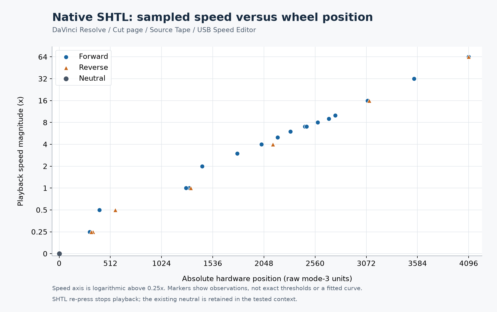

# Native SHTL speed samples and neutral behavior

October 28, 2026, Windows 11, USB Speed Editor, Resolve **Cut page with Source
Tape active**. The mapper stayed disconnected. The user operated the wheel and
reported displayed speeds; REA/Frida observed HID reports in Resolve. Both
tracing sessions were detached, and Resolve remained responsive.

## Neutral is set on mode entry

The observed controls have two distinct behaviors:

| Action | Observed behavior |
| --- | --- |
| Press SHTL while SHTL is already selected | Stop playback; retain the existing neutral |
| Switch to JOG or SCRL, then return to SHTL | Set a new neutral at the current wheel position |
| Turn back toward the existing neutral after an SHTL stop | Resume playback in the direction implied by that existing neutral; decrease forward speed while still on its forward side |
| Return the wheel to neutral | Input position returns to zero |

The user tested stopping near 4× forward, then turning counterclockwise. Playback
resumed **forward** at 3×, 2× and lower rates rather than immediately reversing.
The trace captured SHTL presses near positive positions +2056, +2039 and +2023;
subsequent positions decreased while still positive. No host wheel-mode reset
was captured on those repeated SHTL presses. Evidence:
`ev_0e09b1332933a98cd59cedf3066e9f8bcec56a87f9a9e12b5e1c76579b9ba1e4`.

The user separately reported that switching through JOG/SCRL and returning to
SHTL makes the current wheel position the new neutral. This is consistent with
the earlier observed mode-entry output `03 03 00 00 00 00 ff`, followed by a
zero-position input. That capture is
`ev_698df1ccfc8dfe3aad453f76180431734405008f7d8062f4e5d814f3a438c084`.
The newly described leave-and-return sequence was not traced again; distinguish
that direct user observation from the earlier mode-entry capture.

## Sampled curve

Positions below are signed **mode-3 hardware units**, not degrees or relative
deltas. Resolve's displayed speed is unsigned; direction was reported by the
user. The table contains sampled positions within reported speed plateaus, not
their exact boundaries. Repeated measurements are shown separately.

| Displayed speed | Forward position | Reverse position |
| --- | --- | --- |
| Stopped / neutral | 0 | 0 |
| 0.25× | +305 | −337; later −321 |
| 0.5× | +401 | −562 |
| 1× | +1301; +1268 | −1317 |
| 2× | +1429 | Not sampled |
| 3× | +1782 | Not sampled |
| 4× | +2023 | −2136 |
| 5× | +2184 | Not sampled |
| 6× | +2313 | Not sampled |
| 7× | +2457; +2473 | Not sampled |
| 8× | +2586 | Not sampled |
| 9× | +2698 | Not sampled |
| 10× | +2762 | Not sampled |
| 16× | +3084 | −3100; prior hold at −3084 |
| 32× | +3549 | Not sampled |
| 64× | +4096 | −4096 |

The initial +1718 reading reported as 3× was subsequently described as
fluctuating between 2× and 3×. It is retained as provisional in the session notes
and excluded from the chart and portable samples. The later stable 3× point is
+1782. The user estimated 10× forward was about 90° clockwise from neutral; no
degrees-per-unit calibration is inferred from that estimate.

Forward/reverse measurements at the same displayed speed need not match exactly:
these are manually selected plateau samples with overshoot/correction and
unsynchronized display observations. Do not fit a precise response function,
claim hysteresis, or fill missing reverse speeds from symmetry based on them.
Several trials ended at the Source Tape boundary and were repeated after media
repositioning; reaching a media boundary was not treated as a speed limit.

For the high-speed trials, a distinct held position was identified before the
return to zero. For example, the 16× forward hold was +3084 and the 64× holds
were +4096 and −4096. The final zero after each return was not paired with the
previously observed nonzero speed.

## Saved evidence

- [Portable sample ledger](data/shuttle-curve-2026-10-28.json): 25 non-provisional
  points, individual Evidence IDs/timestamps, provenance, limitations and raw
  bundle SHA-256 hashes.
- [CSV samples](data/shuttle-curve-2026-10-28.csv).
- [SVG chart](images/native-shuttle-curve-2026-10-28.svg).
- Ignored raw bundle `artifacts/rea-shuttle-curve.json`: 42 REA Evidence records.
- Ignored raw bundle `artifacts/rea-shuttle-zero.json`: 44 REA Evidence records,
  including the subsequent neutral-origin experiment.
- Ignored session notes: `artifacts/shuttle-curve-session.json` and
  `artifacts/shuttle-zero-session.json` retain user reports and interruptions.

No capture reported message truncation or script errors. Every position and
timestamp in the portable sample ledger was checked against its retained REA
report. The curve capture includes user-confirmed rates from 0.25× through 64×
in each direction, with fewer intermediate reverse points.

The desktop mapper's Standard transport remains keyboard emulation: its four playback
levels and repeated-SHTL recenter behavior are implementation choices. The native
observations above have not been applied as new default sensitivities. The optional
[Measured desktop mode](MEASURED_TRANSPORT.md) now uses the retained samples
with nearest-sample estimates, absolute hardware mode 3 and the observed neutral
rules. Its desktop output uses explicitly approximate J/K/L commands;
continuous fractional-speed playback remains native to Resolve. The
separate [experimental Resolve adapter](RESOLVE_ADAPTER.md) preserves native
wheel behavior by passing the original reports to Resolve while routing only
explicitly overridden buttons.
